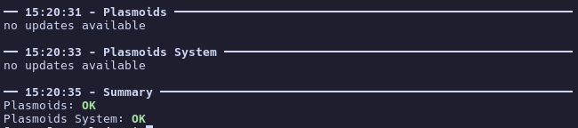

# plasmoid-updater

Updates KDE Plasma 6 components from KDE Store using a combination of Apdatifier's and KDE Discover's logic.

> [!IMPORTANT]
> The core logic (a combination of **Apdatifier** and **KDE Discover**) was ported to Rust with AI assistance (Claude Code and GH Copilot). The code was audited and tested by me. Feel free to contribute with an issue or PR.

## Requirements

- bsdtar and kpackagetool6, for `update` and `install` only (`check` needs neither); `systemctl` too, for the optional plasmashell restart
- `sh` and `stty`, for the interactive selection menu (`sh` also runs `$EDITOR` for `--edit-config`)
- [Rust](https://rust-lang.org/tools/install/)

## Installation

**Using Cargo (Recommended)**
```
cargo install plasmoid-updater
```

**From source using Cargo:**

```
git clone https://github.com/uwuclxdy/plasmoid-updater
cd plasmoid-updater
cargo install --path plasmoid-updater/
```

**Binary release**

Precompiled binary available on [GitHub Releases](https://github.com/uwuclxdy/plasmoid-updater/releases/latest).

## Usage

```
$ plasmoid-updater --help
update kde plasma components from the kde store

Usage: plasmoid-updater [OPTIONS] [COMMAND]

Commands:
  check           check for available updates
  list-installed  list all installed components
  update          update components
  completions     print a shell completion script

Options:
      --system                 operate on system-wide components (needs sudo)
      --edit-config            open configuration file in editor
      --skip-plasma-detection  skip KDE Plasma detection
  -q, --quiet                  errors only on stderr
  -v, --verbose...             more diagnostics on stderr (repeat for debug)
  -h, --help                   Print help
  -V, --version                Print version

project: https://github.com/uwuclxdy/plasmoid-updater
report bugs: https://github.com/uwuclxdy/plasmoid-updater/issues
```

```
$ plasmoid-updater update --help
update components

Usage: plasmoid-updater update [OPTIONS] [COMPONENT]

Arguments:
  [COMPONENT]  component name or directory to update

Options:
      --restart-plasma         automatically restart plasmashell
      --no-restart-plasma      do not restart plasmashell
  -y, --yes                    automatically confirm all updates (TOPGRADE_YES=1 does the same)
      --dry-run                list what would be installed and change nothing
      --ignore <NAMES>         names to skip for this run (comma-separated or repeatable)
      --system                 operate on system-wide components (needs sudo)
      --json                   print the result as JSON on stdout
      --skip-plasma-detection  skip KDE Plasma detection
  -q, --quiet                  errors only on stderr
  -v, --verbose...             more diagnostics on stderr (repeat for debug)
  -h, --help                   Print help

```

`update --dry-run` prints the same table `check` prints — name, current version, available version, store ID, size and type — and touches neither the installed files nor the KDE Store registry. It matches `--ignore` and the config exclusions exactly as a real `update` does. Like `check`, it exits 1 when a component could not be checked; a named dry run answers only for the components it names, exactly as a named `update` does.

`--json` on `check`, `list-installed` and `update` prints one JSON document on stdout and nothing else there: `check` and `update --dry-run` print the check result (a named dry run restricts it to the components the name covers): each `diagnostics` entry carries the install `path` of the component it is about (the path it is restored to for a component a killed run stranded), and `unmatched` lists the components a `--system` run skipped for want of a store entry, so same-named components stay apart; `update` prints the update result, and `list-installed` prints `{"components": [...]}`. Diagnostics, progress and log lines stay on stderr, and the exit codes do not change. An interactive `update --json` still opens the selection menu on a terminal; only the result goes to stdout.

`--ignore` works on both `check` and `update` and skips the named components for that run only, on top of the config exclusions. Example: `plasmoid-updater update --ignore weather,clock`.

Running `plasmoid-updater` without a subcommand prints its help and exits 0. On a terminal, `update` opens an interactive selection menu unless `-y`, `assume_yes`, `update_all_by_default` or a COMPONENT is given; on a non-interactive stdin it refuses without `-y` (exit 2) rather than guessing, unless it names a COMPONENT, runs `--dry-run`, or the config sets `assume_yes` or `update_all_by_default`. `TOPGRADE_YES=1` in the environment confirms the way `-y` does, which is how [topgrade](https://github.com/topgrade-rs/topgrade/) drives an unattended update; any other value confirms nothing. `update [COMPONENT]` matches a component by its display name or directory name — a store ID matches nothing. A name several components share covers each of them: every one answers by its own outcome, and the run exits with the worst outcome. On such a run, every `no update available`, `is excluded` and `no KDE Store entry matches` line, and every `failed to check` line, names the component by its directory name and kind; update rows and the failure table keep the display name. At the selection menu, Escape selects nothing and Ctrl-C ends the run by SIGINT (a shell reports exit status 130). An update that goes ahead (not `--dry-run`, not a refused one) first puts back what a killed run left stranded, even when there is nothing to install.

With `--system`, only a real `update` authenticates through `sudo -v`; `check`, `list-installed` and `update --dry-run` never ask for a password.

By default a run restarts nothing. After updates to widgets, plasma styles, global themes, splash screens or KWin switchers, `--restart-plasma` restarts plasmashell, `prompt_restart = true` in the config asks first (on a terminal only; on a non-interactive stdin the prompt is skipped with a warning naming `--restart-plasma`), and `--no-restart-plasma` skips it. The two flags conflict at parse time (exit 2).

Components that fail to update don't stop the run: the run ends with a one-line summary on stdout naming the non-zero counts (`updated 1 · failed 1 · skipped 2`, with a zero count left out), and it exits 1 when any component failed or could not be checked. An install whose post-install version cannot be verified counts as a failure too, so it exits 1 as well.

## Exit codes

| Code | Meaning |
| ---- | ------- |
| 0 | success |
| 1 | at least one component failed, or an install's version could not be verified, or `check`, `update` or `update --dry-run` could not settle a component |
| 2 | usage error: an unknown option or subcommand, `update <name>` naming no installed component, `update` naming no component without `-y` (or `assume_yes`/`update_all_by_default`) on a non-interactive stdin, conflicting restart flags, or a config directory that is not a directory |
| 3 | the run could not start or finish |
| 100 | `check` found updates to install |

`check` exits 0 when everything is up to date, 100 when updates are available, and 1 when at least one component could not be checked (the reason goes to stderr, naming the component). A failed check outranks an available update: `check` exits 1 rather than 100 so no failure is masked.

## Logging

Only the payload — the tables, the summary, the JSON document, the completion script — goes to stdout. Diagnostics, progress and log lines go to stderr.

Styling follows the rule clap applies to `--help`: `NO_COLOR` set non-empty turns it off, `CLICOLOR_FORCE` set non-empty turns it on even into a pipe, `CLICOLOR=0` turns it off, and otherwise it is on only on a terminal, and there only when `TERM` is set and not `dumb`, `CLICOLOR` is set to anything but `0`, or `CI` is set. The selection prompt and log levels use the same rule on stderr. Progress animates only when stderr is a terminal, so a forced colour into a pipe colours the installed and failed lines without redrawing them.

| Flag | stderr |
| ---- | ------ |
| `-q` | errors only; no progress |
| (none) | warnings, plus progress |
| `-v` | info |
| `-vv` | debug |

`-q` and `-v` are global flags (`plasmoid-updater -q check` and `plasmoid-updater check -q` both work) and cannot be combined. `-v` and `-vv` raise the log level and leave progress on. Log lines read `<level>: <message>`, with the level bold on a colour-capable terminal, and a multi-line message keeps its lines indented under the one entry. `RUST_LOG` is not read.

## Shell completions

`plasmoid-updater completions <SHELL>` prints a completion script on stdout for `bash`, `zsh`, `fish`, `elvish` or `powershell`:

```
plasmoid-updater completions bash > ~/.local/share/bash-completion/completions/plasmoid-updater
```

## Configuration

Settings live in a TOML file at `$XDG_CONFIG_HOME/plasmoid-updater.toml` (usually
`~/.config/plasmoid-updater.toml`). Open it with `plasmoid-updater --edit-config`. Set
`PLASMOID_UPDATER_CONFIG_DIR` to point at a different directory (tests, sandboxes, multiple
profiles).

```toml
# exact name or directory match
excluded_packages = ["widget-name", "another.widget"]
# regex, matched against both the name and directory of each component
excluded_patterns = ["^org\\.kde\\.", "weather"]
update_all_by_default = false
assume_yes = false        # confirm all updates without prompting
prompt_restart = true     # ask before restarting plasmashell
```

`--edit-config` creates the file with commented examples if it does not exist and opens it in `$EDITOR` (`nano` when unset). `$EDITOR` may name a command with arguments (`EDITOR="code --wait"`), which runs through the shell; a path containing spaces needs quoting inside the variable (`EDITOR="'/opt/my editor/ed'"`). A non-zero editor exit fails the run. Excluded components are skipped during updates and hidden from `check`. Invalid regex patterns are dropped instead of aborting the run. A key the file does not recognise fails `check`, `update` and `list-installed` (exit 3) with an error naming the key and the keys it accepts; `--edit-config` still opens the file. `verbosity`, which earlier releases read, is ignored with a warning: `-q` and `-v` set the log level.

## Topgrade integration (preview)

[Topgrade](https://github.com/topgrade-rs/topgrade/) is a CLI tool that updates everything with a single command.

As this is meant to be a part of Topgrade at some point, I thought it's worth showing how to add it as a custom step until it's not officially supported.

Run `topgrade --edit-config` and add the following under `[commands]`:

```toml
[commands]
"Plasmoids" = "plasmoid-updater update -y"
"Plasmoids System" = "plasmoid-updater update -y --system"
```



## Supported (Updatable) Components

| Component Type             | KDE Store Category |
| -------------------------- | ------------------ |
| Plasma Widgets (Plasmoids) | 705                |
| Wallpaper Plugins          | 715                |
| KWin Effects               | 719                |
| KWin Scripts               | 720                |
| KWin Switchers             | 721                |
| Global Themes              | 722                |
| Plasma Styles              | 104                |
| Aurorae Window Decorations | 114                |
| Color Schemes              | 112                |
| Splash Screens             | 716                |
| SDDM Themes                | 101 (system only)  |
| Icon Themes                | 132                |
| Wallpapers                 | 299                |
| Cursor Themes              | 107                |
| Plasma Comic Plugins       | 155                |

SDDM themes live under `/usr/share/sddm/themes` and are only handled with `--system` (needs root). Installs and scans respect `$XDG_DATA_HOME` (default `~/.local/share`), except cursor themes, which install under `~/.icons` as KNewStuff's `xcursor.knsrc` does.

---

## License

Licensed under [GPL-3.0-or-later](https://www.gnu.org/licenses/gpl-3.0.html).

## Acknowledgments & Credits

This project was made possible by studying and learning from:

### [Apdatifier](https://github.com/exequtic/apdatifier)

**Author:** [exequtic](https://github.com/exequtic)
**License:** [MIT License](https://github.com/exequtic/apdatifier/blob/main/LICENSE.md)

Apdatifier is a KDE Plasma widget that monitors for updates to Arch Linux packages, Flatpak applications, and Plasma widgets. The widget update logic, version comparison algorithms, ID resolution fallback chain, and the `widgets-id` mapping table in this project are derived from Apdatifier's implementation.

Concepts taken from Apdatifier:
- 3-tier ID resolution strategy (name matching → KNewStuff registry → static lookup table)
- Version normalization and comparison algorithm
- Download link selection logic for multi-file packages
- Metadata patching approach for installation

### [KDE Discover](https://invent.kde.org/plasma/discover)

**License:** GPL-2.0-only, GPL-3.0-only, LicenseRef-KDE-Accepted-GPL

KDE Discover is the official software center for KDE Plasma. The understanding of KNewStuff registry file formats, kpackagetool6 usage patterns, and OCS API interaction in this project is based on studying Discover's source code.

Concepts taken from KDE Discover:
- KNewStuff registry structure (`.knsregistry` files)
- Installation flow via kpackagetool6
- OCS API v1.6 response format and status codes

### Open Collaboration Services (OCS) API

The [OCS specification](https://www.freedesktop.org/wiki/Specifications/open-collaboration-services/) defines the REST API used by the KDE Store (store.kde.org / api.kde-look.org).

---

*This project is not affiliated with or endorsed by KDE e.V.*
